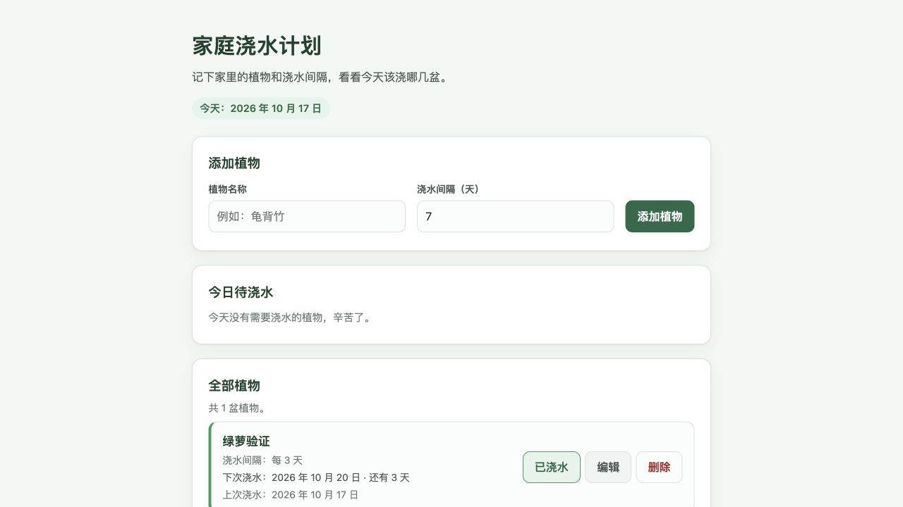

# 可用性连续修复与真实链路验证

2026-10-17，按 Human 批准的第二、三轮计划实施。起点为 Watt `d13ae31e86a1ceb34faeea901e95cd20384e96c0`，当前分支 `claude/c3-formation-ai-native-convergence`。Guardian 已独立提交并推送 `e9019c91a21d954a9d7e243c54b6d01d2bdaa231`，由 `owners.lock` 固定为同一发布单元。完整源码哈希、候选身份和实际证据见 [qualification.json](qualification.json)。本报告不授予生成产品的 Human Acceptance、Integration 或 Delivery。

## 实际行为改变

- 普通完整诉求直接保留原始来源并交给实际产物验证。“实现页面、提供本地预览、不部署公网”的请求不必先由模型反复拆分并审查一次；预览就绪在确切 Candidate 真正提供服务后核对。原有权限、来源、范围和禁止副作用继续生效。
- 明确指定的文件、可逆的新实现范围可以先固定路径，把行为验证留到实际产物。普通导入项目没有产品策略文档时，使用已授权 Work 和精确导入版本；已存在的仓库策略声明仍保留原策略。系统推测的仓库说明只保留为上下文，不能伪装成已证实的仓库身份或用户要求。
- 模型明确标注为安全、可逆、非阻塞的实现问题不再被重复提升为必须回答的 Human 义务；原始问题和完整 Human 子句仍保留。
- 同一页面的 HTML、CSS 和 JS 作为一个可验证的实现任务，避免每个片段被要求独立证明整页完成。真正独立的目标仍使用多任务计划；既有已执行图不会被静默改写。
- “重新尝试”既记录新的有界恢复轮次，也为明确失败的执行或失败验证启动合法的后继 Attempt。效果未知、执行中、已封存或已授权结果不能据此重放。无进展达到上限后，执行器不再把自己撤回工具造成的等待误报为外部资源短缺而无限排队。
- 实际失败的诊断测试可在现有写权限和任务范围内驱动实现修复，不能修改验收含义、扩大路径或消除不确定效果。工作区过长决策标题不再造成 HTTP 500。
- Guardian 在单次串行评估内对每个精确证据引用只读取一次；下次评估重新读取。多任务完整目标集合按实际活动任务图和分支范围核对，仍独立验证分支输出进入最终 Candidate。

## 真实验证结果

隔离 PostgreSQL、Gitea、实际模型、Native Executor 和容器工具执行。未使用模拟模型或预造 PASS 代替实际链路。四条当前候选均达到实现验证 PASS、实际 Preview READY、Guardian PASS（零 Finding），Human Acceptance 均保持 PENDING。

| 链路 | Work | 结果 |
|---|---|---|
| 完整原样混合需求：阅读清单、localStorage、本地预览、禁止公网部署 | `70e93d20-e7e7-532f-a050-981f67de2e82` | 原测试 Work 经正常有界重试产出候选；浏览器验证添加、已读切换、未读筛选、刷新保存和删除 |
| 原游戏最后已接受的关卡核心诉求 | `7a206dca-49b8-5822-af0f-cdf9a136dbc0` | 三个任务单元和最终候选审查通过；浏览器观察种植、僵尸波次、失败结算和重新开始 |
| 原样三文件浇水页面 | `5073fb63-18a7-53d6-9e93-a18326b100e7` | 一个完整任务生成三个指定文件；浏览器验证添加植物、今日待浇水、浇水后日期更新和刷新保存 |
| 已导入项目修改及同一 Work 后续反馈 | `a4f4b20f-4724-5bc7-b41e-eb17ad696c5e` | 初次删除确认/数量统计候选通过；同一会话提出增加“阅读进度”标题后产生新候选并再次验证/审查通过，旧候选保留 |

删除确认弹窗已在真实浏览器观察。当前浏览器自动化在取得可取消句柄前已处理确认，因此没有把该次操作声称为“浏览器取消成功”；取消保留原数据、确认后删除及统计更新另外通过对确切候选脚本的 Node VM 执行检查，测试双替代 DOM/storage/confirm，见 [existing-artifact-unit.json](existing-artifact-unit.json) 与 [执行脚本](existing-artifact.test.cjs)。游戏不声称完成浏览器胜利通关或原版素材复刻。

生成与实现验证发生于工程迭代期间。随后冻结全部修改源码、固定并重新加载 staged Owners，在全体隔离运行角色上重新服务相同确切候选并发起新的独立 Guardian 评估，四条均再次通过。新请求及结果在本目录保留；旧失败、未完成审查和重试历史没有覆盖。历史全量诊断和 trace 留在隔离运行目录，哈希已入清单；压缩工作区与精确审查记录作为可复核证据提交。

## 检查与保留失败

- 受影响回归：1174 通过、55 个 PostgreSQL 项未配置时跳过、3 个已确认起点基线失败（wire feedback 的 duplicate-response/duplicate-validation，以及 next_request_limit）。未放松旧断言。
- 最终实现/恢复/上下文/规划聚焦检查：179 通过；收紧当前验收条件后的 staged 检查：18 通过。
- Guardian 全套：331 通过；增加导入项目真实证据后 staged 正负检查：17 通过（包含新增 4 项）。
- 真实 PostgreSQL 的恢复/证据聚焦检查：5 通过。额外扩大运行先发现 7 项失败，停止扩展后在起点 Watt/Guardian 源码逐项重现同样 7 项；它们不是本轮修复通过的声明。记录见 postgres-baseline-reproduction.log。其余 45 项额外 PostgreSQL 用例未继续运行。
- Compose/运行配置检查：提供必需的本地验证实例变量后 4 通过。初次未提供 WATT_REVISION/节点身份变量的配置检查失败，未改动断言或生产配置来掩盖它。
- Git diff 检查及已知隔离凭证值扫描通过。未提交环境文件、数据库连接、登录凭证或实际模型密钥。

原先被按文件扩展名过度拆分的浇水测试 Work `f6eb6337-b5db-5e5b-961d-bc960ca16d64` 保持停止，其失败和已执行图保留；修正规划后用同一完整输入新建的 Work 通过。本轮不承诺所有已执行旧图自动重构。生产游戏 Work `b1e59aa3-eaf3-5c6a-8bc0-fa0eff470ad9` 未被本次资格验证重试、清空、改写或验收，发布还会对其核心持久记录作前后指纹比较。

